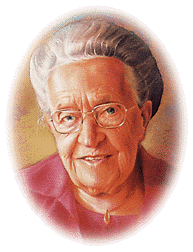



<h1>Wielkie postaci chrześcijaństwa 
Corrie ten Boom</h1>

Wąska uliczka w centrum Haarlem w Holandii. Środek dnia, mnóstwo ludzi biegających, wchodzących do różnych sklepów, robiących zakupy, jedzących coś na szybko i biegnących dalej. Na rogu tej tłocznej uliczki znajduje się budynek, na którym  widnieje napis : zegarki Ten Boom. Wchodzimy do środka, mnóstwo zegarków, sklep,  mili sprzedawcy pytają co podać, ale my jesteśmy zainteresowani czymś innym, historią, która wydarzyła się w tym miejscu, w tym budynku ponad 60 lat temu. Po wąskich schodach prowadzi nas przewodnik do mieszkania na piętrze nad sklepem, opowiada historie niesamowite, prawdziwe związane z rodziną Ten Boom, z czasów wojny. Zasiadamy w krzesłach w pokoju rodziny Ten Boom, wiele historii, prawdziwych, niezwykłych a ponad wszystko ten spokój wewnątrz mieszkania  wśród tego zabiegania na zewnątrz, na ulicy... Oto historia związana z tym miejscem, z kobietą oddaną całkowicie Bogu. Myślę, że gdy jej posłuchamy oddamy chwałę Bogu i zobaczymy Jego wielkość i miłość ponad wszystko.

W 1837 roku, Willem Ten Boom założył sklep z zegarkami w Haarlem. W późniejszym okresie przejął sklep jego syn Casper a potem jego córka Corrie. Corrie ten Boom urodziła się w 1892 r. Od lat jej ojciec i rodzeństwo poświęcało się w służbie pomocy potrzebującym ludziom. Ich dom był " domem otwartym" dla innych. Byli bardzo zaangażowani w różne działania charytatywne w Haarlem. Kiedy nastała Druga Wojna Światowa zaczęli na różne możliwe sposoby ukrywać Żydów. W ich domu powstała słynna kryjówka. Była to maleńkich rozmiarów przestrzeń /3 m x 1 m/ zamurowana ścianą. Dojście do tej kryjówki było poprzez szafę tak więc w chwili "łapanek" kilkanaście osób znajdowało tam miejsce schronienia. Dom rodziny Ten Boom wraz z kryjówką był pewnego rodzaju punktem przerzutowym – kiedy znaleziono miejsca w innych rodzinach, daleko na wioskach, wtedy Ci  ludzi udawali się tam a nowi zajmowali szybki ich miejsca. W ten oto sposób rodzina Ten Boom uratowała wielu Żydów przez hitlerowską zagładą.

Niestety 28 lutego 1944 r. stała się rzecz tragiczna, działania rodziny Ten Boom zostały zgłoszone policji nazistowskiej i 6 członków rodziny wraz z Corrie zostało aresztowanych i wywiezionych do obozu koncentracyjnego. W następnych dniach zostało pojmanych  następnych 30 osób zaangażowanych w tą pracę. Opustoszały dom był pod ciągłą kontrolą Niemców. W momencie aresztowania w "kryjówce" było sześciu Żydów, którzy przez prawie trzy dni bez wody i jedzenia czekali na uwolnienie.

Casper, ojciec Corrie  umarł w wieku 84 lat w więzieniu, podobny los spotkał innych członków rodziny. Corrie wraz ze swoją siostrą Betsie została wywieziona do obozu koncentracyjnego w Ravensbruck. Był to bardzo ciężki okres dla obu sióstr. W rezultacie Betsie poważnie zachorowała i umarła w obozie-tydzień przed możliwym ich zwolnieniem. Był to niesamowity cios dla Corrie. W swojej książce " Prisoner and yet..." wspomina : " straszna samotność napełniła me serce, jestem sama, już nie będę miała tych cudownych, pocieszających i dodawających otuchy rozmów z Betsie. Ale nagle uczucie pokoju wpłynęło do mego serca, i uczucie prawdziwej radości, mnie dotknęło. Mówił do mnie Duch Boży : Pan dał, Pan wziął, błogosławione niech będzie imię Pańskie. Pobiegłam do umywali gdzie składano umarłych by zobaczyć ciało Betsie. Wyglądała niewiarygodnie młodo, zobaczyłam jej twarz pełną pokoju i szczęśliwą jak dziecko. Był to kawałeczek nieba pośrodku otaczającego nas piekła. Potężna radość od Pana wpłynęła do mojego serca. Wołałam w modlitwie : Ucz mnie, Panie, nieść me brzemię, wśród ciemności, smutku, łez. Nie daj bym się żalić miała przed innymi. Ucz mnie nieść wszystkie burze ziemi, serca. Daj bym mogła spokojnie cierpieć, zgodnie z wszystkim wola Twą. Chcę w słabości moc Twą poznać, naucz mnie być dzieckiem Twym".

<h2>W 1945 r. w pierwszy dzień Nowego Roku Corrie wyszła na wolność...</h2>

Dopiero w 1959 r. odwiedzając ponownie obóz w Ravensbruck dowiedziała się,  że jej zwolnienie z obozu było dziełem urzędniczej "pomyłki". Tydzień później wszystkie kobiety z jej baraku powędrowały do komory gazowej.

Bóg czuwał nad jej życiem. Po wojnie dużo podróżowała dzieląc się świadectwem mocy Boga. Napisała ponad 20 książek. Odwiedzała różne kraje a w 1964 r. odwiedziła również Polskę. 10.08.1964 r. wygłosiła również swe świadectwo w Zborze w Bielsku-Białej. Bardzo lubiła używać różnych pomocy do przedstawienia pewnych prawd. Wtedy też pokazała latarkę. Powiedziała :

"Ona nie daje światła ale nie jest zepsuta, ma tylko jedną baterię. Nie było miejsca na drugą baterię bo jej miejsce zajmują brudne szmatki. Nic więc dziwnego, że nie może ona dawać światła. Ta pierwsza bateria to pierwsza komnata wielkiego pałacu. Kiedy przyjąłeś Pana Jezusa, Bóg uczynił Cię swoim dzieckiem i to nie jest koniec lecz dopiero początek pałacu. Jest w nim wiele komnat do przejścia. On chce abyśmy byli ciągle napełnieni Jego Duch Świętym. Te brudne szmatki to : niewiara, duma, niewłaściwe relacje, nieczyste myśli i czyny itd.... "

W innym miejscu podczas świadectwa pokazała zebranym prostokątny kawałek materiału z niewyraźnym zarysem jakiegoś kształtu, haftowanego kolorowymi /złotymi/ nićmi. Nikt nie mógł powiedzieć co ten obrazek przedstawia. Strzępy różnokolorowych nitek, niewyraźne brzegi, nierówności – nie przedstawiały wyraźnego obrazu. Następnie odwróciła ku zebranym drugą stronę tkaniny. Zobaczyć można było na niej wspaniale wyhaftowany obraz korony. "Tak jest i z naszym życiem - powiedziała – nieraz nie widzimy w nim sensu. Wydaje się nam one nieładem i gmatwaniną. Natomiast z Bożej strony przedstawia się ono zupełnie inaczej – wszystko jest na swoim miejscu, jest wyraźne i celowe."

Pewnego razu w jednym z dużych miast w biurze podróży Corrie Ten Boom załatwiała sobie rezerwacje na przeloty samolotem do wielu różnych miast w różnych krajach. Zaintrygowana tym faktem urzędniczka zapytała ją jakie jest końcowe-docelowe miasto Pani podróży ? Wówczas Corrie bez namysłu i zdecydowanie odpowiedziała : "Niebo". Urzędniczka zaczęła pilnie szukać nazwy takiego miasta, w swoich wykazach. Po chwili pilnego szukania stwierdziła z zakłopotaniem : "proszę Pani ale ja nie mam w moich wykazach nazwy takiego miasta". Wtedy Corrie z uśmiechem odpowiedziała: "w pani wykazach na pewno go nie ma ale ja pani dam taką książeczkę, w której jest dokładnie to miasto opisane i wręczyła jej Nowy Testament. Dodała : " z tej książeczki będzie się pani mogła dowiedzieć jakie miasto będzie pani stacją końcową – czy będzie nią Niebo czy Piekło". Zaskoczona i poruszona tym urzędniczka poprosiła Corrie o rozmowę. Efektem tej rozmowy było nawrócenie się tej urzędniczki, ponieważ i ona chciała wiedzieć i być pewna jakie miasto będzie stacją końcową jej podróży.

Corrie Ten Boom zmarła 15 kwietnia 1983 r. Odeszła do tego, którego tak bardzo kochała i któremu poświeciła wszystkie swoje siły. Weszła do rzeczywistości i tego końcowego miasta, do której tak bardzo tęskniła.

Tak więc, drodzy "...mając wokół siebie tak wielki obłok świadków, złożywszy z siebie wielki ciężar i grzech, który nas usidla, biegnijmy wytrwale w wyścigu, który jest przed nami, patrząc na Jezusa..."/Hebr.12,1/

Wszystkich zachęconych powyższą historią odsyłam do niezwykle interesującej książki "Bezpieczna kryjówka" napisaną przez Corrie Ten Boom oraz filmu video, który jest skróconą ekranizacją tej książki.

  
 
<h4>Wersja HTML Copyright (C) 2000 by Czytelnia Chrześcijanina</h4>
 


