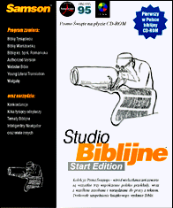



<h1>
			Studio Biblijne 
			Biblioteka Pisma Świętego na płycie CD-ROM

		</h1>

Studio Biblijne jest pierwszą na polskim rynku publikacją Pisma Świętego w postaci programu komputerowego umieszczonego na płycie kompaktowej CD-ROM. Do powstania programu przyczyniło się wiele osób i instytucji (m.in. Fundacja Źródła Życia). Głównymi autorami są Krzyszfot Samsonowicz i Zenon Korosteński z firmy <a href="http://www.samson.pl">Samson Digital Systems</a>, która jest producentem Studia.

Jednym z największych sukcesów naszej cywilizacji jest umiejętność gromadzenia potężnych zasobów informacji oraz ich udostępniania. Autorzy, tworząc Studio Biblijne, mieli na celu przedstawienie ponadczasowego piękna Biblii przy wykorzystaniu najnowszych osiągnięć techniki. Na płycie CD-ROM zgromadzili wszystkie najpopularniejsze przekłady całej Biblii na język polski wraz z łacińską Wulgatą i przekładami angielskimi tworząc prawdziwą bibliotekę Pisma Świętego. Biblioteka tekstów w postaci elektronicznej daje całkowicie nowe podejście do zagadnień powiązanych z wszelkim badaniem Biblii i jest pożytecznym uzupełnieniem wydań książkowych. Obecnie mamy do dyspozycji trzy najpopularniejsze tłumaczenia polskie: Biblię Tysiąclecia, Biblię Warszawską (tzw. "Brytyjkę"), Biblię Warszawsko-Praską (ks. bp K. Romaniuka), łacińską Wulgatę oraz angielskie: Young's Literal Translation, Webster Bible, King James Authorized Version. Na pochwałę zasługuje fakt, iż uwzględniono wszystkie używane współcześnie tłumaczenia polskie, ponieważ dotychczas jedyną dostępną w postaci elektronicznej była Biblia Tysiąclecia. Rozczarowują natomiast tłumaczenia w języku angielskim. Program jest skierowany do użytkownika polskiego, dla którego angielski nie jest językiem ojczystym lecz wyuczonym. Umieszczenie jedynie tłumaczeń pochodzących sprzed stu lub więcej lat (King James rok 1611, Webster rok 1833, Young's LT rok 1898) znacznie utrudnia lekturę ponieważ Biblie te pisane są bardzo starą i dla nas trudną angielszczyzną. Aż prosi się o dodanie np. The Good News Bible (ostatnie wydanie z 1994 roku) będącą znakomitym współczesnym tłumaczeniem skierowanym do osób posługujących się angielskim na całym świecie. Pożytecznym byłoby też dodanie wydania w języku greckim. Na szczęście autorzy zapewniają, iż już wkrótce będzie można wzbogacić swoją elektroniczną bibliotekę o nowe pozycje, włączając inne tłumaczenia Biblii oraz, co bardzo interesujące, teksty pomocnicze takie jak komentarze, książki, pisma, mapy a nawet zasoby multimedialne.

Program Studio Biblijne wyposażony jest w prosty interfejs obsługi, który tworzony był z myślą o wszystkich miłośnikach Pisma Świętego. Jego wygląd i sposób działania przypomina amerykański program Study Bible, na którym prawdopodobnie Studio jest wzorowane (to bardzo dobry wzorzec). Czas realizowania zamierzeń jest szybszy niż w przypadku tradycyjnych wydań książkowych. Daje się zauważyć, że autorzy wiele lat studiowali Biblię ponieważ zadbali by najważniejsze dla czytelnika opcje były zawsze pod ręką. Wygląd programu nie odbiega od współcześnie używanych aplikacji dla Windows 95 co zaoszczędza czas na naukę programu. Mamy więc menu, kilka pasków z przyciskami umożliwiającymi wywołanie najpopularniejszych poleceń, listwę statusu oraz duże okno główne, w którym wyświetlany jest tekst Biblii. Wybrane przekłady można wygodnie porównać wyświetlając je interlinearnie. Termin ten z pewnością nie jest obcy nikomu, kto miał do czynienia z profesjonalnymi wydaniami Pisma Świętego. Jest to przedstawienie przekładów w taki sposób, aby wersety o tych samych numerach umieszczone były dokładnie pod sobą. Możemy wyświetlać trzy przekłady w układzie interlinearnym. Ciekawą jest możliwość jednoczesnego porównywania dwóch wersetów podobnych ale znajdujących się w innych miejscach tekstu przez podzielenie głównego okna na dwie części i wyświetlenie w każdej z nich innego fragmentu. 

Standardowe wyposażenie programu Studio Biblijne to narzędzia do szybkiego poruszania się w tekście, tworzenia i edycji tematów biblijnych (jest ich ponad 200), odsyłaczy i profesjonalnych zakładek, które mogą zaznaczać nawet dużą liczbę wersetów. Wygodna i szybka nawigacja po tekście jest jedną z podstawowych zalet Studia. Najpotężniejszym jednak narzędziem jest Korkondancja. Umożliwia ona prawie bezbłędne znalezienie przedmiotu poszukiwań. Otrzymujemy możliwość wyszukiwania jednego lub więcej wyrazów przez podanie np. które wyrazy mają wystąpić oraz które wystąpić nie mogą. Zaawansowany użytkownik może konstruować nawet bardzo wyrafinowane kryteria wyszukiwania. Znalezione wersety można zapisywać na dysku, oglądać w kontekście całego rozdziału, grupować w tematy. Podczas lektury tekstu zachodzi często potrzeba skomentowania pewnego rozdziału Biblii tak, aby jednocześnie komentarz nie przeszkadzał w swobodnym czytaniu tekstu. Studio umożliwia proste wpisywanie i podglądanie komentarzy w osobnym oknie u dołu ekranu.

Program Studio Biblijne jest bardzo otwarty. Od samego początku został zaprojektowany w taki sposób aby istniała możliwość dodawania do niego wciąż nowych materiałów, które mają być dostępne poprzez Internet. Jest też zgodny z innymi aplikacjami Windows 95. Można przenosić wersety do ulubionego edytora tekstu (np. Word, Ami Pro), włączać je do swojej pracy, wymieniać się danymi z innymi użytkownikami lub upiększyć własną korespondencję cytatami z Biblii. Do dyspozycji użytkownika jest dość obszerna, wbudowana w program pomoc kontekstowa, podręcznik użytkownika oraz serwer internetowy firmy Samson Digital Systems (http://www.samson.pl). Wymagania sprzętowe to PC 486, 8 MB RAM, 45 MB wolnego miejsca na twardym dysku, napęd CD-ROM, Windows 95. Szkoda, że program instaluje się w całości na twardym dysku zabierając na nim dużo cennego miejsca. Przydatną byłaby opcja uruchamiania Studia bezpośrednio z płyty kompaktowej.

Podsumowując, firma Samson Digital Systems wykonała niezwykle pożyteczną pracę wydając program Studio Biblijne. Jest to wydarzenie bez precedensu na polskim rynku wydawnictw chrześcijańskich. Zalety i możliwości programu zapewnią każdemu użytkownikowi wiele satysfakcji. Miejmy nadzieję, że autorzy jak najszybciej usuną drobne niedociągnięcia i będą systematycznie dostarczali nam kolejne materiały wzbogacające Studio Biblijne o nowe możliwości. Polecam Studio wszystkim użytkownikom komputerów by nabrali nowego spojrzenia na Pismo Święte.

<i>Piotr Wasilewski</i>

<a href="/czytelnia/swch-programy-index-e2918a0b6/">

<b>Powrót do strony głównej</b>

</a>

 


